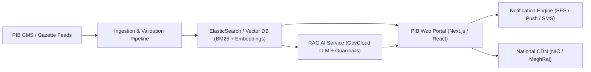

# Press Information Bureau (PIB) Website Redesign
## AI-Powered Government Information Platform — College Research Prototype

[](https://antigravity.google)
[](https://vite.dev)
[]()
[](LICENSE)

---

## 1. Project Overview & Background

This project is a complete, polished, responsive, and interactive redesign of the official **Press Information Bureau (PIB), Government of India** website ([https://www.pib.gov.in/](https://www.pib.gov.in/)).

### Objective
Redesign the user experience of India's nodal government information agency to drastically improve **search**, **information discovery**, **readability**, **historical archive access**, **language accessibility**, and **mobile usability**, introducing an **AI Assistant** and **personalized subscription digest system** while strictly preserving the authenticity, branding, and integrity of official Government of India publications.

### Development Mandate
- Developed exclusively using **Google Antigravity** as the sole AI pair-programming and development tool.
- Fully runnable on **localhost** without requiring paid APIs, cloud subscriptions, external databases, or hosting services.
- Grounded in an authentic, local demonstration dataset of Government of India press releases spanning from 2014 to 2026.

---

## 2. Official PIB Website Inspection Findings

Before writing code, the live website at `https://www.pib.gov.in/` was inspected. The key structural, visual, and architectural findings are documented below:

1. **Official Brand & Identity:**
   - **National Emblem:** The State Emblem of India (Ashoka Lion Capital with the national motto *"सत्यमेव जयते"* in Devanagari script).
   - **PIB Roundel Symbol:** The official circular seal featuring the quill nib and Ashoka Chakra motif with Indian tricolor accents.
   - **Primary Palette:** Deep Government Navy Blue (`#0b3558`), Slate Blue (`#133b5c`), National Tricolor Saffron (`#ff9933` / `#ea580c`), and India Green (`#138808` / `#15803d`).
2. **Ministry & Release Architecture:**
   - Organized across Union Ministries (PMO, Finance, Defence, Health, Science & Tech, MeitY, Education, Agriculture, etc.).
   - Every announcement is issued with a unique **Press Release ID (PRID)**, location stamp (e.g., *New Delhi*), publication date/time in **Indian Standard Time (IST)**, and nodal ministry attribution.
3. **Accessibility (GIGW Guidelines):**
   - Official PIB includes a dedicated accessibility toolbar featuring font size scaling (A-, A, A+) and theme options: High Contrast (`change.css` / `pib-hc`), Warm Ochre/Yellow (`pib-theme-yellow`), and Eco Green (`pib-theme-green`).
4. **Historical Archive Challenges:**
   - Legacy gazette releases from 2014–2021 frequently encounter deprecated server links or 404 attachment errors, necessitating a graceful broken-link recovery and incident reporting workflow.
5. **Multilingual Architecture:**
   - PIB publishes releases primarily in Hindi and English, with regional translations in 14+ Scheduled Indian languages. Official government policy requires that official gazette releases are translated by verified nodal officers—not replaced by synthetic approximations.

---

## 3. Approved Features & Local Implementation

The redesign integrates all eight approved features into one cohesive, accessible web platform:

### 1. PIB AI Assistant (`/assistant`)
- **Architecture:** Rule-based, source-grounded assistant operating over the local demonstration repository without external paid API keys.
- **8 Supported Demonstration Use Cases:**
  1. *Summarise a selected release:* Produces structured executive bullet points with key takeaways.
  2. *Explain a release in simple language:* Breaks down complex policy jargon into plain, citizen-friendly explanations (*सरल व्याख्या*).
  3. *Extract dates, figures, and eligibility:* Pulls out quantitative targets (e.g. ₹12.8 Lakh Crore capex, 9.8 Crore beneficiaries) and eligibility rules into structured data cards.
  4. *Search releases by topic, ministry, and date:* Matches announcements dynamically based on topics like space, railways, chips, or farming.
  5. *Identify related announcements:* Traces interconnected policy initiatives across ministries.
  6. *Display available language versions:* Reports verified language pairs (English and Hindi).
  7. *Generate Current Affairs Revision Notes:* Creates comprehensive General Studies (GS-III) dossiers with prelims/mains takeaways for UPSC and competitive exam aspirants.
  8. *Compare two releases:* Generates comparative side-by-side matrices (e.g., Chandrayaan-3 vs Chandrayaan-4, or 2014 Jan Dhan vs 2024 PM Surya Ghar).
- **Integrity Guardrail:** Clearly badges AI explanations vs. official source citations. If a user queries topics not present in the dataset, the assistant honestly discloses that the local demonstration dataset does not contain verified records, refusing to hallucinate government facts.

### 2. My PIB Feed — Subscription Workflow (`/my-pib-feed`)
- **Step 1:** Select from 10 policy categories and specific Union ministries. Select format types (Press Releases, Factsheets, Feature articles).
- **Step 2:** Enter subscriber email address with regex validation and error messaging.
- **Step 3:** Select dispatch frequency (Instant alerts, Daily digest, Weekly summary) and choose scheduled delivery time in **Indian Standard Time (Asia/Kolkata UTC+05:30)** (e.g., 08:00 AM, 01:00 PM, 07:00 PM).
- **Step 4:** Review complete configuration.
- **Step 5:** Activation confirmation, `localStorage` persistence, and an interactive **Representative Email Preview** showing an authentic PIB dispatch preserving complete release text and source attribution.

### 3. Smart Search 2.0 (`/search`)
- Full search across headlines, full text, PRIDs, excerpts, and ministries.
- **Typo-Tolerant Suggestions:** Detects common misspellings (e.g. *"samikunduktor"* → *"semiconductor"*, *"chndryan"* → *"chandrayaan"*, *"byudget"* → *"budget"*).
- **Combined Filters:** Ministry selector, Category pill, Content format, Language toggle, Date ranges, and Newest/Oldest sorting.
- **Query Persistence:** Retains filter criteria and search parameters in URL query strings across navigation.
- **Zero-Result Handling:** Shows active filters, suggests spelling corrections, offers related topics, provides date broadening guidance, and includes a one-click reset.

### 4. Personalised Homepage (`/`)
- **Role-Based Discovery Mode:** Optional 1-click presets for *General Citizen*, *Journalism / Media*, *Competitive Exams (UPSC)*, and *Academic Researcher*.
- Prioritizes preferred categories in the feed without altering the availability of any official announcements.
- Default view is rich, complete, and uncompromised for first-time visitors.
- 1-click *"Reset to Default"* button.
- Saved in browser `localStorage`.

### 5. Related-Release Grouping (`/release/:id`)
- Every record defines explicit `relatedReleaseIds` connecting related national initiatives.
- Preserves the distinct identity, PRID, date, and attribution of every original release.
- Includes a dedicated thematic track section on the homepage illustrating grouped policies (e.g., Capital Investment & Self-Reliance).

### 6. Historical Archive Explorer & Broken-Link Recovery (`/archives`)
- Dedicated archive interface with quick year filter timeline (2014, 2015, 2019, 2020, 2021, 2022, 2023, 2024, 2025, 2026).
- Date range filtering, category filters, and keyword search.
- **Broken-Link Recovery Workflow:** Includes deliberate unavailable legacy documents (such as the *2021 PM GatiShakti Gazette* and *2019 PM-KISAN Cabinet Resolution*). Clicking unavailable attachments opens an interactive recovery modal providing:
  - Transparent error explanation.
  - Interactive *"Retry Recovery"* simulation querying archive mirrors.
  - *"Report Problem to Webmaster"* form that generates verified incident tracking tickets (`#PIB-A11Y-XXXXX`).
  - Verified alternative official government portal link.
  - Return-to-results action.

### 7. Mobile-First Accessibility
- Responsive across standard breakpoints: Desktop (1440px), Tablet (768px), and Mobile (375px) without horizontal scrolling.
- **Accessibility Toolbar:**
  - Accessible font size toggling: Regular (100%), Large (112.5% / 18px), and Extra Large (125% / 20px).
  - 4 Contrast Themes: Standard Navy, High Contrast Dark (`pib-hc`), Warm Parchment Yellow (`pib-theme-yellow`), and Eco Green (`pib-theme-green`).
  - Screen reader *"Skip to Main Content"* link.
  - Live Indian Standard Time clock (`Asia/Kolkata`).

### 8. Language Support Improvements
- Integrated language selector for paired English and Hindi releases.
- Native Unicode rendering for Devanagari scripts (`Noto Sans Devanagari`).
- Official published translation pills on release pages.
- Clear distinction between official authorized translations and AI/synthetic explanations.

---

## 4. Technology Stack

- **Framework:** React 19 + TypeScript (strict typing)
- **Bundler & Server:** Vite 8.3
- **Routing:** React Router v7 (`react-router-dom`)
- **Styling:** Tailwind CSS v4 (`@tailwindcss/vite`) with custom CSS custom properties for accessibility themes
- **Icons:** Lucide React
- **Storage:** Browser `localStorage` (Preferences, Subscriptions, Persona)
- **Zero Paid Dependencies:** No cloud databases, third-party trackers, or paid AI APIs required.

---

## 5. Local Setup & Running Instructions

### Prerequisites
- Node.js version 18+ (tested on Node v24.14.1)
- npm version 9+ (tested on npm 11.11.0)

### Step 1: Install Dependencies
Open terminal in the project directory and run:
```bash
npm install
```
*(On Windows PowerShell, use `npm.cmd install` if script execution is restricted).*

### Step 2: Start Local Development Server
Start the Vite local development server:
```bash
npm run dev
```
*(Or `npm.cmd run dev`).*

The terminal will display the active localhost URL:
```text
  VITE v8.3.4  ready in 1307 ms

  ➜  Local:   http://localhost:5174/
  ➜  Network: use --host to expose
```
Open **`http://localhost:5174/`** in any web browser.

### Step 3: Run Automated Test & Verification Suite
To execute the automated test suite testing the demonstration dataset, search filters, all 8 assistant use cases, and local routes:
```bash
npm test
```
*(Or `npm.cmd test`).*

### Step 4: Build for Production
To verify TypeScript compilation and bundle generation:
```bash
npm run build
```

---

## 6. Demonstration Dataset Summary

The repository includes **32 authentic, detailed records** (26 primary announcements with paired Hindi counterparts) in `src/data/releases.ts`, spanning 12 Union Ministries from 2014 to 2026:

| PRID | Title / Subject | Ministry | Date | Content Type | Attachment Status |
| :--- | :--- | :--- | :--- | :--- | :--- |
| **2094821** | Union Budget 2026-27: ₹12.8L Cr Capex & Tax Relief | Finance | 01 Feb 2026 | Press Release | Available PDF |
| **2094822** | केंद्रीय बजट 2026-27 (Hindi Version) | Finance | 01 Feb 2026 | Press Release | Available PDF |
| **2094910** | India Semiconductor Mission Phase-II (₹40,000 Cr) | MeitY | 14 Feb 2026 | Press Release | Available PDF |
| **2095114** | ISRO Chandrayaan-4 Lunar Sample Return CDR | Science & Tech | 28 Feb 2026 | Press Release | Available PDF |
| **2095280** | PM-KISAN 19th Installment Disbursal (₹21,500 Cr) | Agriculture | 05 Mar 2026 | Press Release | Available PDF |
| **2095390** | 6th Positive Indigenisation List & Record Exports | Defence | 12 Mar 2026 | Press Release | Available PDF |
| **2095510** | Ayushman Bharat PM-JAY Universal Senior 70+ Cover | Health | 18 Mar 2026 | Factsheet | Available PDF |
| **2095620** | National Green Hydrogen Mission (1.8 GW Capacity) | Environment | 22 Mar 2026 | Press Release | Available PDF |
| **2095730** | Vande Bharat Sleeper Trains Flag-Off (160 kmph) | Railways | 25 Mar 2026 | Press Release | Available PDF |
| **2095840** | NEP 2020 5-Year Review: 32 Cr APAAR Student IDs | Education | 29 Mar 2026 | Factsheet | Available PDF |
| **2081920** | India-EFTA TEPA Treaty ($100 Billion Investment) | Commerce | 15 Nov 2025 | Press Release | Available PDF |
| **2083415** | National Quantum Mission: 4 Thematic Hubs | Science & Tech | 04 Oct 2025 | Press Release | Available PDF |
| **2065810** | One Year of G20 New Delhi Declaration & Biofuels | MEA | 09 Sep 2024 | Feature | Available PDF |
| **2054320** | PM Surya Ghar: Muft Bijli Yojana (1.3 Cr Registrations) | PMO | 16 Jul 2024 | Factsheet | Available PDF |
| **2041930** | Bharat 6G Vision: 111 Standard Patents Granted | MeitY | 17 May 2024 | Press Release | Available PDF |
| **2033280** | Foodgrain Production Record (332.3 Million Tonnes) | Agriculture | 22 Apr 2024 | Factsheet | Available PDF |
| **1951528** | Chandrayaan-3 Historic Moon Landing at South Pole | PMO / ISRO | 23 Aug 2023 | Press Release | Available PDF |
| **1956012** | G20 New Delhi Leaders' Declaration (100% Consensus) | MEA | 09 Sep 2023 | Press Release | Available PDF |
| **1860142** | National Logistics Policy (NLP) & ULIP Platform | Commerce | 17 Sep 2022 | Press Release | Available PDF |
| **1763630** | PM GatiShakti National Master Plan (₹100L Cr) | PMO | 13 Oct 2021 | Press Release | **Unavailable (Recovery Test)** |
| **1562205** | Cabinet Approval of PM-KISAN Scheme (2019) | Agriculture | 01 Feb 2019 | Press Release | **Unavailable (Recovery Test)** |
| **1072931** | Pradhan Mantri Jan Dhan Yojana (PMJDY Launch 2014) | Finance | 28 Aug 2014 | Press Release | Verified Archive |
| **1642049** | National Education Policy 2020 Cabinet Approval | Education | 29 Jul 2020 | Press Release | Available PDF |
| **1081152** | Make in India Global Manufacturing Initiative (2014) | Commerce | 25 Sep 2014 | Press Release | Available PDF |
| **1212450** | Digital India Week Inauguration (2015) | MeitY | 01 Jul 2015 | Press Release | Available PDF |
| **1559410** | National Clean Air Programme NCAP (102 Cities) | Environment | 10 Jan 2019 | Factsheet | Available PDF |
| **2028190** | PMAY 3 Crore Additional Pucca Houses Approval | PMO | 10 Jun 2024 | Press Release | Available PDF |

---

## 7. Local Features Checklist

- [x] **Official Branding & Identity:** Ashoka Lion Capital SVG, official PIB roundel, bilingual masthead, Indian tricolor stripe.
- [x] **Smart Search 2.0:** Keyword matching, partial-word matching, typo tolerance suggestions, combined filters, zero-results guidance, URL state persistence.
- [x] **PIB AI Assistant:** 8 demonstration use cases supported, grounded citations with PRID and ministry, clear distinction badge, honest fallback on missing records.
- [x] **My PIB Feed:** 5-step wizard, category/ministry multi-select, email validation, IST delivery scheduling (`Asia/Kolkata`), authentic email preview, localStorage persistence.
- [x] **Personalised Homepage:** 4-persona presets (General, Journalist, Aspirant, Researcher), category prioritisation, 1-click reset, default fallback.
- [x] **Related-Release Grouping:** Explicit `relatedReleaseIds`, preserved original identities, thematic track grouping.
- [x] **Historical Archive Explorer:** 2014–2026 timeline filter, keyword search, load-more interaction.
- [x] **Broken-Link Recovery:** Deliberately unavailable historical documents, retry simulation, problem report form generating incident tickets, verified alternative links.
- [x] **Language Support:** Bilingual English & Hindi releases, Unicode script font support, translation switcher.
- [x] **Accessibility & Themes:** Font sizing (A, A+, A++), 4 themes (`default`, `pib-hc`, `parchment`, `eco-green`), skip-to-content anchor, live IST clock.
- [x] **Responsive Design:** Verified on 1440px desktop, 768px tablet, and 375px mobile without horizontal scrolling.
- [x] **Zero-Cost Constraint:** Operates 100% offline on localhost with open-source stack and no paid API keys.

---

## 8. Known Limitations of the Prototype

1. **Rule-Grounded Assistant:** The current assistant uses deterministic rule matching and local dataset grounding. It is not connected to a live generative LLM API to maintain zero cost and prevent hallucination of government policies.
2. **Localhost Search Scope:** Search operates against the demonstration dataset of 32 curated releases rather than the 500,000+ releases in the full historical PIB archive.
3. **Simulated Email Dispatch:** The subscription workflow saves preferences in `localStorage` and renders an authentic email preview; it does not connect to an SMTP server or external mail service.
4. **Demonstration Translations:** Bilingual translations are provided for primary flagship releases; not all historical records have a paired Hindi counterpart.

---

## 9. Practical Roadmap for Future Production Deployment

In a future production deployment sponsored by the Government of India, the following architectural upgrades would be integrated:



1. **Live Publishing Ingestion Pipeline:** Connect to PIB's internal Content Management System (NIC CMS) via authenticated REST/GraphQL webhooks with digital cryptographic signatures (eSign/PKI).
2. **Hybrid Search & Vector Indexing:** Implement Elasticsearch or Meilisearch paired with dense vector embeddings (e.g., multilingual BGE-M3) for semantic search across 22 Scheduled Indian languages.
3. **Enterprise AI Model Integration:** Connect a private, self-hosted LLM on Government Cloud (NIC MeghRaj) with Retrieval-Augmented Generation (RAG). The model would cite specific paragraph numbers and gazette page numbers with verifiable digital watermarks.
4. **Automated Multilingual Pipeline:** Integrate the Government of India's **Bhashini** AI translation and speech-to-speech platform for automated draft translation, verified by human nodal press officers before publishing.
5. **Production Email & SMS Infrastructure:** Deploy high-throughput email servers with double opt-in, DKIM/SPF/DMARC authentication, and SMS gateway integration (NIC SMS Gateway) for critical disaster or national security alerts.
6. **Automated Archive Web Crawler & Gazette Mirroring:** Implement automated daily health checks for historical gazette PDFs, with automated failover to the National Archives of India (NAI) and IndiaCode mirrors.
7. **Security & Compliance:** Full compliance with GIGW 3.0, CERT-In cybersecurity standards, and the Digital Personal Data Protection (DPDP) Act 2023.
